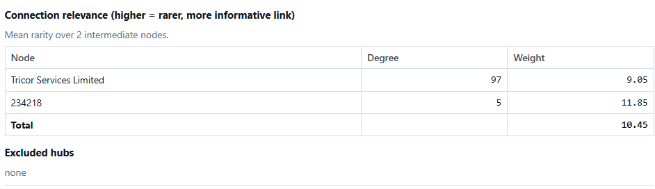
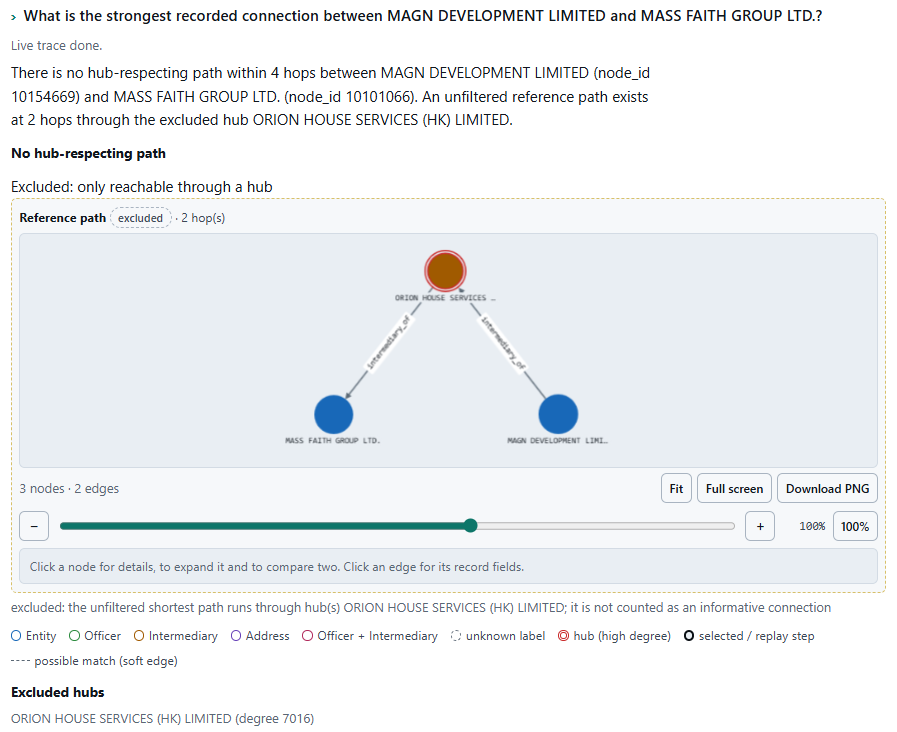
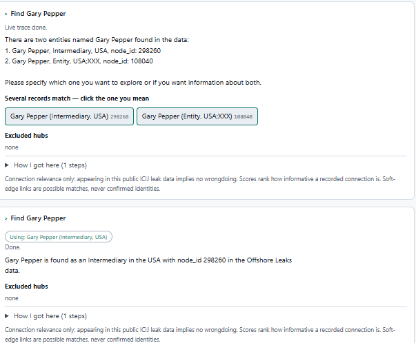
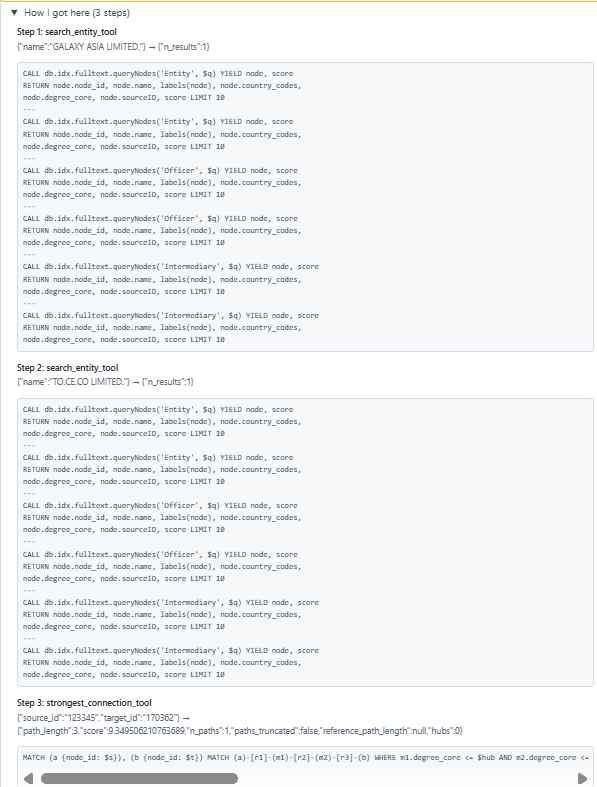
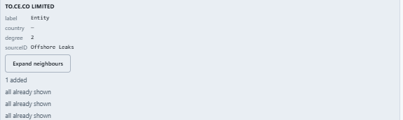
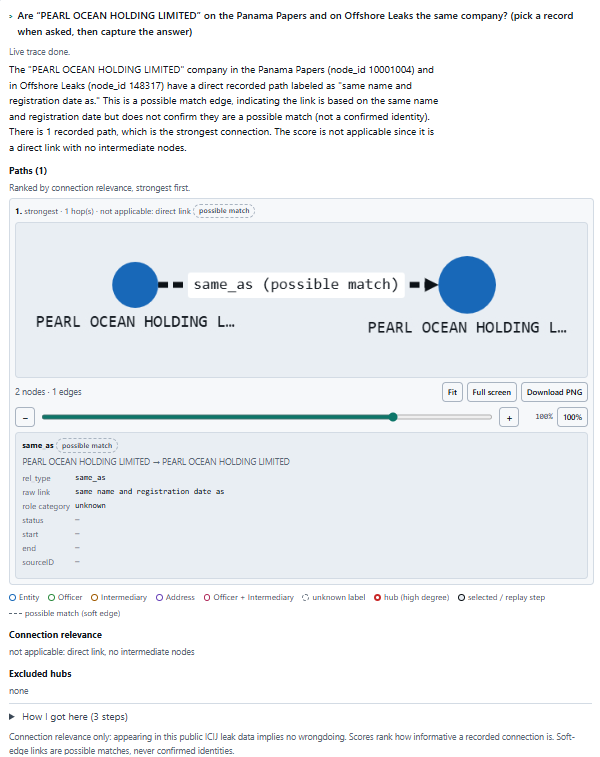
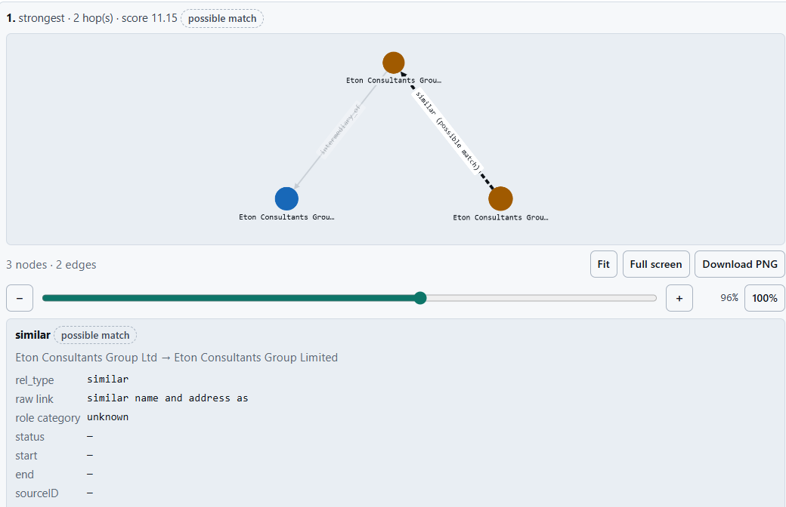
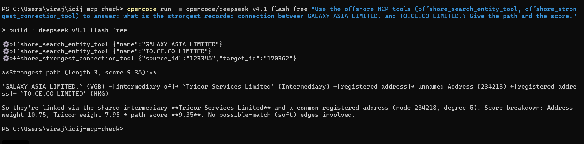
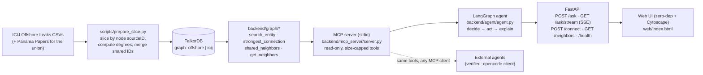
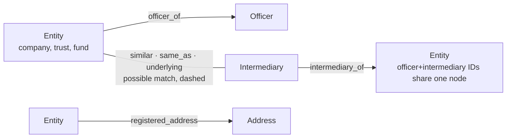

# offshore-investigator

An investigation agent that answers questions about the **ICIJ Offshore Leaks** data by traversing a **FalkorDB graph**, ranking connections with an explainable rarity-weighted **connection relevance score**, and showing the **paths, records and degrees** behind every answer.

Built for the WeMakeDevs x FalkorDB **Graph Hacks** hackathon — Track 1: *Agents That Act on Connected Data*.

**What makes it a graph product (and not a search box):** every answer is a traversal. The agent plans *search → expand → strongest path*, the "strongest connection" between two records is computed with a Cypher path search that prunes high-degree hubs *inside* the traversal, and each answer returns the full path, every relationship type, the source record IDs and the node degrees used to score it. Remove FalkorDB and there is no product left — see [Why the graph is essential](#why-the-graph-is-essential).

> **Neutral language, always:** appearing in this public data implies **no wrongdoing**. The score measures how *informative and rare* a recorded connection is — it is **not** a probability that anything is wrong. Any `similar` / `same_as` / `underlying` edge is a **possible match**, never a confirmed identity.

---

## What you can try

Open the UI (`http://127.0.0.1:8000`) and ask, for example:

1. **The flagship cross-jurisdiction chain** — *"What is the strongest recorded connection between GALAXY ASIA LIMITED. and TO.CE.CO LIMITED.?"* → a clean 3-hop path: VGB company → HKG intermediary (Tricor Services Limited) → HKG address → HKG company; score ≈ **9.35 (offshore)** (≈ **10.45 (icij)** on the union), no hubs needed. Two jurisdictions crossed, every hop explainable.
2. **The hub story** — *"What is the strongest recorded connection between MAGN DEVELOPMENT LIMITED and MASS FAITH GROUP LTD.?"* (graph `icij`) → every route would run through **ORION HOUSE SERVICES (HK) LIMITED** (degree 7,016), so the tool reports **no hub-respecting path within the depth limit**, **lists the excluded hub with its degree**, and shows the unfiltered reference path so you can see *why the answer changed*. *(On `offshore` the same idea is Braggle Ltd. ↔ ASIAN DRAGON (BVI) LIMITED through the unnamed 37,338-degree Portcullis address.)*
3. **The possible-match case** — *"Is 'Eton Consultants Group Ltd' the same company as 'Eton Consultants Group Limited'?"* → one `similar` edge, flagged `includes_possible_match`, and the answer must say **possible match** — never "same company".

The repo also ships a mined, tool-verified catalogue of 11 complex questions across 8 categories (deep paths, hub-blocked, ambiguity, cross-dataset…) in [`docs/COMPLEX_QUESTIONS.md`](docs/COMPLEX_QUESTIONS.md), and a 20-question graded manual set in [`docs/TEST_QUESTIONS.md`](docs/TEST_QUESTIONS.md).

## Screenshots

Each of these is a real UI answer card (capture list and the exact question to type: [`docs/img/CAPTURE.md`](docs/img/CAPTURE.md)):

| | |
|---|---|
|  |  |
|  |  |
|  |  |
|  |  |

## Architecture



The LLM does exactly two things: **pick a tool** and **turn structured tool results into a plain-language answer**. Pathfinding, filtering and scoring are Cypher + Python — deterministic, auditable, cacheable.

## The graph model



- **Nodes** are exactly one record per ID (labels `Entity`, `Officer`, `Intermediary`, `Address`). ICIJ reuses IDs across the officer and intermediary files: **1,139 overlapping IDs are stored as one node with both labels** (verified: identical names and country codes in all 1,139 cases — decision D4). `must be explainable` wins over "two pretty nodes".
- **Every node** carries `node_id`, `name`, `countries`, `country_codes`, `sourceID` (which leak), and precomputed **`degree_core`** (undirected distinct neighbors over the three core edge types) + `degree_all`.
- **Every edge** keeps the raw link text, a normalized `role_category` (`unknown` stays `unknown`), `status`, `from`/`to` dates and the relationship `sourceID` — the graph never invents edges, and every answer can quote the underlying record.
- **Soft edges** (`similar`, `same_as`, `underlying`) are separate relationship types, opt-in semantics: they are returned by default but every result that touches one carries `includes_possible_match` + `possible_match_edges` + a note, and the agent must label them **possible match**. (This is a documented, user-approved deviation from the original "soft edges opt-in" decision — the trade is recorded in `docs/DECISIONS.md`, D6 deviation.)
- Grouped property tricks (list-of-pairs) are avoided on purpose — each node/edge value is a scalar so every row is greppable.

## Why the graph is essential

Test applied during design: *if removing FalkorDB leaves a feature working, that feature is wrong.* Concretely, these product behaviours are **Cypher-shaped**:

- **Strongest connection** between two records: iterative-deepening exact-depth path search with a **hub predicate on every intermediate hop** (removing hubs *inside* the traversal), ranked by mean rarity of the intermediate nodes. A post-hoc Python filter over an unfiltered path list timed out at 60 s next to the 36k-degree hub; the in-traversal prune returns in milliseconds. (Findings in `docs/DECISIONS.md`.)
- **Hub awareness**: `degree_core` is precomputed at import; the hub filter lives in the `MATCH` pattern (`WHERE n.degree_core <= $hub`), so high-degree nodes are pruned **while expanding**, not after. Excluded hubs are always **listed with their degree**, never silently dropped, and the answer includes the unfiltered reference path when it differs.
- **Shared structure** (`shared_neighbors`) and **expansion** (`get_neighbors`) are both single bounded traversals with the same in-pattern hub predicate.
- **Everything on the screen is a returned path** — node degrees, edge fields, and the score breakdown all come from the same query result. No second database, no re-derivation in Python.

## Hub awareness and the connection relevance score

**Formula** (per answer):

```
score(path) = mean over intermediate nodes m of  ln( (N + 1) / (degree_core(m) + 1) )
N = number of nodes in the graph (live count)
```

- **Mean, not sum** — padding a path with extra hops cannot raise the score.
- **Endpoints contribute nothing** — the question is about what *links* two records, not how famous the records are.
- **Relative, not absolute**: `N` is read live, so the *same* connection scores higher on the bigger union graph (N = 838,293 → **+1.10** shift vs the 278,693-node offshore graph). Scores are meant to be compared **within one graph**.
- **The score is relative to the size of the loaded graph (N = node count)**, so the same path scores about 1.1 higher on `icij` than on `offshore`. Compare scores within one graph, not across graphs.
- **Relevance, not probability**: a high score means "this link is rare and specific in this dataset"; appearing in the data means nothing about wrongdoing.
- **Direct links** have no intermediate nodes → the score is **not applicable** and every surface (tool result, API, UI, agent answer) says `not applicable: direct link, no intermediate nodes` instead of printing a number.
- **Hubs**: default threshold `degree_core <= 1000`. High degree is not "fake" — it just makes a link less informative (one of tens of thousands of shared-address links), which is exactly what the `ln` weighting encodes.

**Score by graph** — the star pairs from the test docs, measured with `strongest_connection` (read-only, no LLM) on each server. The clean pair shows the predicted shift (+1.10); Panama-only names have no `offshore` value, and the hub-blocked pair has no hub-respecting path on either graph.

| Pair (doc id) | `offshore` | `icij` |
|---|---|---|
| GALAXY ASIA LIMITED. ↔ TO.CE.CO LIMITED. (flagship / J1 / T2Q1) | 9.35 | 10.45 |
| GALAXY ASIA LIMITED. ↔ PERFECT INVESTMENTS COMPANY LIMITED. (D1) | 8.79 | 9.91 |
| Julius J. Grodski ↔ Zodiac Concepts Inc. (J2) | 11.44 | 12.54 |
| TO.CE.CO's address partner (170206) ↔ GALAXY ASIA (M1 follow-up) | 7.95 | 9.05 |
| Gary Pepper (108040) ↔ Giltbridge Trading Limited (A1) | 10.93 | 12.03 |
| The M.Y.H. Trust ↔ The Victoria & Daniel Trust (T2Q2) | 9.83 | 10.93 |
| JDC HOLDINGS S.A. ↔ INTERTRADE SYSTEMS LTD (P1) | — (Panama-only) | 12.03 |
| ERNHARD COMPANY LTD. ↔ CALYPSO STAR LTD. (P2) | — (Panama-only) | 12.03 |
| GALAXY NIGHT WORLDWIDE INC. ↔ ELFERS UNITED INC. (P5) | — (Panama-only) | 11.07 |
| MAGN DEVELOPMENT LIMITED ↔ MASS FAITH GROUP LTD. (H2 / P3) | — (Panama-only) | no hub-respecting path (excluded hub named) |

Direct-link pairs (Eton Consultants Group Ltd/Limited, PEARL OCEAN HOLDING LIMITED cross-dataset) carry no score by design on either graph — `not applicable: direct link`.

## Two graphs

| Graph (`GRAPH_NAME`) | Contents | Nodes / Edges | Notes |
|---|---|---|---|
| `offshore` (default) | ICIJ Offshore Leaks — all five jurisdictions in the slice | 278,693 / 562,700 | the demo default |
| `icij` (union) | Offshore Leaks + Panama Papers | 838,293 / 1,286,362 | same schema; adds cross-dataset `same_as` (the single deliberate cross-dataset soft-edge demo: PEARL OCEAN HOLDING LIMITED) |

Both are built from the same prepared-file format; the union is just a bigger slice (all node sourceIDs included) loaded into a second graph. The demo cache ships answers for the default graph; set `GRAPH_NAME=icij` in `.env` to run the Panama demos.

## Setup from a fresh clone

Prerequisites: Docker (with Compose), Python 3.12, and the **public ICIJ CSVs** (~600 MB) from <https://offshoreleaks.icij.org/pages/database> ("><i>Download the full database</i>") — keep them **outside the repo** and see [Data & attribution](#data--attribution). `tmux` is used for keeping the API alive (any process manager works). The companion checklist with the reasoning behind each step is [`docs/SETUP_GOTCHAS.md`](docs/SETUP_GOTCHAS.md).

```bash
git clone <this repo> && cd offshore-investigator
cp .env.example .env                    # set DATA_DIR + one LLM key/model (names in the file)
# 1. engine (localhost-only ports)
docker compose up -d
# 2. fresh clone: point the first volume of docker-compose.yml at "$DATA_DIR/import_root"
#    (left side of the import_root mount; the committed value is the dev box)
# 3. slice + degrees (stdlib-only, reads $DATA_DIR, writes $DATA_DIR/prepared)
.venv/bin/python scripts/prepare_slice.py          # expect: nodes 278,693 · edges 562,700 · CHECK OK
# 4. hardlink the prepared files into the import root (LOAD CSV may only read there)
mkdir -p "$DATA_DIR/import_root"
cp -l "$DATA_DIR/prepared/"* "$DATA_DIR/import_root/"
# 5. raise the load timeout (resets on every container recreate)
docker exec offshore-investigator-falkordb-1 redis-cli GRAPH.CONFIG SET TIMEOUT 600000
# 6. load (~14 s; prints per-label/type counts and CHECK OK)
.venv/bin/python scripts/load_graph.py --drop
# 7. API (survives the shell)
tmux new-session -d -s uvicorn '.venv/bin/python -m uvicorn backend.app.main:app --host 127.0.0.1 --port 8000 >> runs/uvicorn.log 2>&1'
curl -s http://127.0.0.1:8000/health               # {"status":"up","nodes":278693,...}
```

Then open **<http://127.0.0.1:8000>**.

- **No venv yet?** `python3.12 -m venv .venv && .venv/bin/pip install -r requirements.txt` (7 packages, no build tools needed).
- **Full-text name indexes** are created automatically when the MCP server starts (first question) — no manual step. If you `--drop`-reload while an external MCP client stays connected, restart that client. Manual fallback: `PYTHONPATH=. .venv/bin/python -c "from backend.graph.search_entity import ensure_search_indexes as e; e()"` (add `GRAPH_NAME=icij` for the union).
- **Union graph (Panama Papers):**
  ```bash
  .venv/bin/python scripts/prepare_slice.py --slices "Panama Papers,Offshore Leaks" \
      --out "$DATA_DIR/prepared_icij" --expect-nodes 838293 --expect-edges 1286362
  mkdir -p "$DATA_DIR/import_root/icij" && cp -l "$DATA_DIR/prepared_icij/"* "$DATA_DIR/import_root/icij/"
  GRAPH_NAME=icij .venv/bin/python scripts/load_graph.py --drop --prepared icij --expect-nodes 838293 --expect-edges 1286362
  ```
  (Then set `GRAPH_NAME=icij` in `.env` and restart the API to demo it.)
- **Never recreate the container without re-checking** `docker compose ps` + `/health` — and if `nodes` reads 0, reload from the prepared folder (steps 4–6); the FalkorDB volume is mounted at both persistence paths precisely to survive recreates (see SETUP_GOTCHAS).

## Environment variables

All names and placeholders are in [`.env.example`](.env.example). **Never commit `.env`; keys are read from the environment only, never printed or logged.**

| Variable | Purpose |
|---|---|
| `DATA_DIR` | directory holding the ICIJ CSVs (outside the repo); also `prepared/` and `import_root/` |
| `GRAPH_NAME` | `offshore` (default) or `icij` (union) |
| `FALKORDB_HOST` / `FALKORDB_PORT` | engine address (compose binds `127.0.0.1` only) |
| `LLM_PROVIDER` / `LLM_MODEL` | **switch providers without code changes**: `groq`, `openrouter` or `openai` + the model id for that provider |
| `GROQ_API_KEY` / `OPENROUTER_API_KEY` / `OPENAI_API_KEY` | key for the selected provider only |
| `LLM_CALL_TIMEOUT_S` / `LLM_MAX_ATTEMPTS` | per-call timeout and hard retry cap — a rate-limited provider fails fast with a clear message instead of hanging |
| `MAX_LLM_CALLS_PER_RUN` | hard cap on LLM calls per question (default 8) |
| `ASK_TIMEOUT_S` / `ASK_RATE_PER_MIN` / `DAILY_LLM_CAP` | API guards: request timeout, rate, daily LLM budget |

- `DAILY_LLM_CAP` defaults to `100` fresh LLM calls per day (counter: `runs/llm_usage.json`, resets at the server's local midnight) — change the value in `.env` and **restart the server** to apply it; the counter itself is re-read per request.
- Cached demo answers neither consume the budget nor get blocked when the cap is reached; only fresh agent runs are counted and capped.

## Using the MCP server from another client

The agent talks to the graph through a **stdio MCP server** (`backend/mcp_server/server.py`) that exposes read-only, size-capped tools written to be picked by *another* model:

| Tool | One line |
|---|---|
| `search_entity_tool` | find Entity/Officer/Intermediary nodes by name (exact hits first, optional country/label) |
| `strongest_connection_tool` | strongest hub-respecting path between two node_ids, with score breakdown, excluded hubs and an unfiltered reference |
| `shared_neighbors_tool` | common neighbors of two nodes, hubs listed not dropped |
| `get_neighbors_tool` | expand one node, hub-filtered, with a hub-centre guard |

Run it under any MCP client: `.venv/bin/python backend/mcp_server/server.py` on stdio. **Verified with an external client**: a second, independent agent (opencode in an empty folder with only an MCP config) discovered and called `offshore_search_entity_tool` ×2 + `offshore_strongest_connection_tool(123345, 170362)` and answered the flagship question correctly (3 hops, 9.35 (offshore)) in ~20 s — exact config, command, and the WSL/Windows wrapper gotcha are in [`docs/MCP.md`](docs/MCP.md).

## Cypher queries and graph algorithms the product depends on

The full registry lives in [`docs/QUERIES.md`](docs/QUERIES.md) (purpose, parameters, the actual Cypher, measured latency). Summary:

| # | Query / algorithm | Used by |
|---|---|---|
| Q1 | node_id btree index per label | loader (endpoint lookup) |
| Q2 | `LOAD CSV … CREATE` nodes, degrees cast with `toInteger` | loader |
| Q3 | `LOAD CSV … CREATE` edges, label-blind endpoint resolution via one indexed `OPTIONAL MATCH` per label + `coalesce` | loader |
| Q4 | count queries per label/type + total | loader verification |
| Q5 | sample direction + hub-degree sanity check | loader verification |
| Q6 | **strongest-connection candidates**: exact-depth chains `(a)-[r1]-(m1)-[r2]-(b)` with `m.degree_core <= $hub` on every intermediate + iterative deepening 1..max_hops; score = mean rarity. Plus the unfiltered reference via `CALL algo.SPpaths` (Dijkstra fast path; bounded SPpaths uses DFS enumeration and timed out, so it is never called with `maxLen`) | `strongest_connection` tool, `POST /connect` (no LLM) |
| Q7 | full-text name search `CALL db.idx.fulltext.queryNodes(label, $q)` union of raw + punctuation-stripped term, exact-first ranking | `search_entity` tool |
| Q8 | shared neighbors: `MATCH (a)-[r1]-(n)-[r2]-(b)` with `n.degree_core <= $hub` in-pattern; hubs listed by a second query | `shared_neighbors` tool, `POST /connect` |
| Q9 | neighbor expansion: `MATCH (a)-[r]-(n)` with the hub predicate on the neighbour; centre hub-guard via indexed degree lookup; count + excluded-hub queries for the truncation note | `get_neighbors` tool, `GET /neighbors` (UI expand) |

**Registry audit (every query in the code):** Q1–Q9 cover the whole answer path (Q6–Q9) and the whole import/verification path (Q1–Q5), each parameterized where user input is involved, depth-bounded, `LIMIT`ed and given an explicit `timeout=`. The only executing Cypher not in the registry is the `/health` node-count probe (`MATCH (n) RETURN count(n) LIMIT 1`) — the same count shape as Q4. `scripts/smoke_falkordb.py` writes a throwaway `*_smoke` graph on purpose (engine reachability check; never touched by the product). No other query exists in `backend/` or `scripts/`.

## Tests

| Test | What it proves | Run |
|---|---|---|
| `backend/tests/test_llm_guard.py` | 16 checks, **no LLM calls**: retry cap (a failing client is attempted exactly 3× then fails fast), timeout → clear error, `POST /ask` returns 429 with the human message, SSE emits one `error` event and no `final`, request-timeout → 504, and answer-grounding samples (score/degree/name checks) | `.venv/bin/python backend/tests/test_llm_guard.py` (no server needed, no keys used) |
| `scripts/check_ask.py` | replays cached demo questions through a running API and asserts the rid + question echo (guards the "stale answer" bug class) | `curl`-style script against a live server |
| `scripts/try_tools.py` | exercises the four graph tools directly (no LLM) | `.venv/bin/python scripts/try_tools.py` |
| `scripts/smoke_falkordb.py` | engine reachability | `.venv/bin/python scripts/smoke_falkordb.py` |
| Manual graded set | 20 questions incl. ambiguity, hub-blocked, soft-edge and cross-dataset tiers; results and the re-grade (12 cached questions through the API, 0 LLM) in [`docs/TEST_RESULTS.md`](docs/TEST_RESULTS.md) | by hand in the UI/API |

Answer-grounding runs in the agent itself: every id, name, degree and quote in a generated answer is checked against the tool results before the answer is returned; a violation is replaced with a deterministic fallback.

## Known quirks and limitations

Honest list — these are **documented, not hidden** (each one is recorded in `docs/DECISIONS.md`, `docs/COMPLEX_QUESTIONS.md` or `docs/TEST_QUESTIONS.md`):

- **No shared-structure (officer + address + intermediary) demo pair found yet** — 18 offshore + 12 union intermediaries were mined; the graphs have strong *pairs*, no verified triple. We say so rather than fake one.
- **No deep Panama-only path pair** yet (4–5 hops, non-hub, core-only) — the heavy read-only mining query hit the time box; the 2-hop Panama pairs (score 12.03 (icij)) are in the test set.
- **Depth 6 is not safe on hub-blocked pairs** (the candidate query hits its 15 s timeout — measured 15.68 s); **depth 5 is** (0.16–0.97 s measured on all pairs).
- **Name search has limits**: address nodes carry no name field (address hubs cannot be resolved by name — by design, and by data); RediSearch tokenizes punctuation loosely, mitigated by querying the raw and punctuation-stripped forms and unioning.
- **Soft edges are possible matches** — there is no entity resolution beyond ICIJ's own records; the single cross-dataset `same_as` edge is presented as a possible match.
- **`role_category` is `unknown` for most registry-style links** (address/intermediary edges carry no role text) — the raw link text is always kept so it can be recomputed.
- **Scores are relative to the graph** (`N` = live node count) — compare within one graph, not across.
- **Free-tier LLM quotas**: demo answers are cached in `runs/cache.json` (the cache is the first-class demo path); a rate-limited provider now fails fast with *"the language model is rate-limited, try again in a minute"* in the UI instead of hanging.
- **519k relationship rows have an empty `sourceID`** — slicing is by *node* sourceID by design.

## Data & attribution

- Data: **ICIJ Offshore Leaks Database** (and Panama Papers in the union graph) — <https://offshoreleaks.icij.org>. CSV downloads, license and terms: see the [database page](https://offshoreleaks.icij.org/pages/database). Data © ICIJ and contributors.
- **Code license:** MIT (see [`LICENSE`](LICENSE)) — it covers the code in this repository only; the ICIJ data is **not** covered by it and keeps its own terms.
- Raw CSVs are **never committed** to this repo (`*.csv` is gitignored); only derived slice files live outside the repo under `$DATA_DIR`.
- **This project is an independent demonstration. Appearing in this data does not imply wrongdoing, and none of these outputs imply anything about any person or company.** The agent is additionally instructed to use neutral language, to call soft edges "possible match", and to repeat this disclaimer at the end of every answer.
- Real personal names appear in the data (as published by ICIJ); the UI and answers deliberately avoid characterizing people or entities.

## AI assistance disclosure

Built by Viraj with heavy but reviewed AI assistance, logged per task in [`docs/AI_USAGE.md`](docs/AI_USAGE.md):

- **opencode** used as the coding agent for implementation and documentation (models: Muse Spark / DeepSeek v4.1 Flash per task, see the log).
- **Claude** used for planning and prompt writing.
- Every query, score and design choice was reviewed and can be explained by the author; the AI never writes directly to FalkorDB without a registered, parameterized query in `docs/QUERIES.md`.
